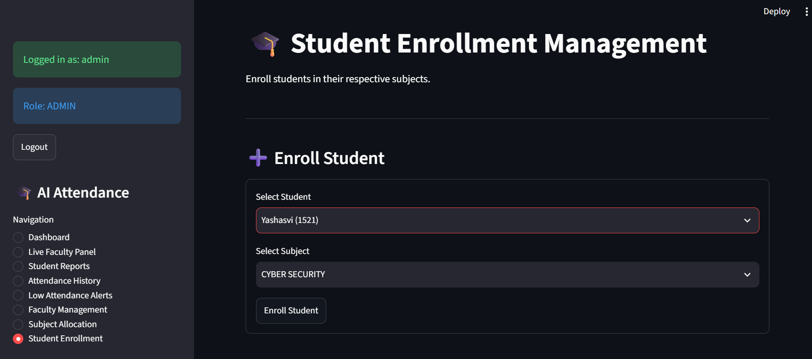

# AI Smart Attendance System

An AI-powered attendance management system that combines **face recognition and hand gesture verification** to automate classroom attendance. The system uses a Streamlit dashboard for attendance monitoring and analytics, with SQLite for data storage.

## Overview

Traditional attendance systems are time-consuming and can be prone to proxy attendance. This project aims to make classroom attendance smarter, faster, and more reliable using computer vision and AI.

The system identifies registered students through facial recognition and verifies their presence using a randomly generated hand gesture challenge before marking attendance.

## Key Features

* **Face Recognition:** Identifies registered students using the LBPH face recognition algorithm.
* **Hand Gesture Verification:** Uses MediaPipe to detect and verify hand gestures.
* **Random Gesture Challenges:** Generates gesture challenges to add an additional verification step.
* **Automated Attendance:** Marks attendance after successful identity and gesture verification.
* **Duplicate Prevention:** Prevents a student from being marked present multiple times in the same session.
* **Student Registration:** Captures and stores student face images for model training.
* **Subject Enrollment:** Allows students to be enrolled in specific subjects.
* **Faculty Management:** Supports faculty accounts and subject allocation.
* **Session Management:** Creates subject-wise classroom attendance sessions.
* **Analytics Dashboard:** Provides attendance statistics and visual reports.
* **Attendance History:** Tracks attendance records across sessions.

## Technology Stack

| Component               | Technology  |
| ----------------------- | ----------- |
| Programming Language    | Python      |
| Face Recognition        | OpenCV LBPH |
| Hand Gesture Detection  | MediaPipe   |
| Computer Vision         | OpenCV      |
| Dashboard               | Streamlit   |
| Database                | SQLite      |
| Data Processing         | Pandas      |
| Data Visualization      | Plotly      |
| Development Environment | VS Code     |

## System Architecture

The system follows this workflow:

1. **Student Registration:** Captures student facial images and stores student information.
2. **Model Training:** Trains the LBPH face recognition model using registered student images.
3. **Session Creation:** Faculty creates an attendance session for an allocated subject.
4. **Face Recognition:** The webcam captures a student's face and identifies the registered student.
5. **Gesture Verification:** The system generates a random hand gesture challenge.
6. **Attendance Validation:** The system verifies the student's enrollment and checks for duplicate attendance.
7. **Attendance Recording:** Successful verification results in attendance being stored in the SQLite database.
8. **Dashboard Analytics:** Attendance records are displayed through the Streamlit dashboard.

## Project Structure

```text
AI-Smart-Attendance/
│
├── dataset/
│
├── models/
│   ├── face_model.yml
│   └── student_details.json
│
├── .venv/
│
├── face_detection.py
├── student_registration.py
├── train_model.py
├── face_recognition.py
├── hand_detection.py
├── gesture_verification.py
├── database.py
├── session_database.py
├── attendance_system.py
├── dashboard.py
├── analytics.py
├── auth.py
│
├── hand_landmarker.task
├── requirements.txt
├── .gitignore
└── README.md
```

*Note: Local datasets, trained model files, virtual environments, and database files are excluded from the public repository.*

## Installation and Setup

### 1. Clone the repository

```bash
git clone https://github.com/yashasviswami2/AI-Smart-Attendance-System.git
```

### 2. Navigate to the project directory

```bash
cd AI-Smart-Attendance-System
```

### 3. Create a virtual environment

```bash
python -m venv .venv
```

Activate it on Windows:

```powershell
.\.venv\Scripts\Activate.ps1
```

### 4. Install dependencies

```bash
pip install -r requirements.txt
```

### 5. Configure required model files

Place the MediaPipe Hand Landmarker model file (`hand_landmarker.task`) in the project root directory.

Register students and train the face recognition model before running the attendance system.

### 6. Run the attendance dashboard

```bash
python -m streamlit run dashboard.py
```

The dashboard will open in your browser.

## Database

The project uses SQLite to manage:

* Student information
* User authentication
* Faculty accounts
* Faculty subject allocations
* Student subject enrollments
* Classroom sessions
* Attendance records

## Security and Privacy

* Student facial images and biometric datasets should be handled responsibly.
* Personal datasets and local database files are excluded from version control.
* Passwords are stored using salted PBKDF2-HMAC-SHA256 hashing.
* Student attendance is validated against subject enrollment.

This project is intended for academic and demonstration purposes. Real-world deployment requires appropriate consent, privacy safeguards, and security testing.

## Future Enhancements

* Real-time attendance monitoring for larger classrooms.
* Improved face recognition under different lighting conditions.
* Cloud-based database integration.
* Student and faculty notification system.
* Advanced attendance analytics and reporting.
* Deployment on a cloud platform.

## Screenshots
### Student Enrollment Management




## Project Status

**Development in Progress**

The system is being developed incrementally, with a focus on AI-based identity verification, automated attendance management, and interactive analytics.

## Author

**Yashasvi Swami**

B.Tech Computer Science and Engineering

GitHub: [@yashasviswami2](https://github.com/yashasviswami2)

---

If you find this project interesting, consider giving the repository a ⭐!
